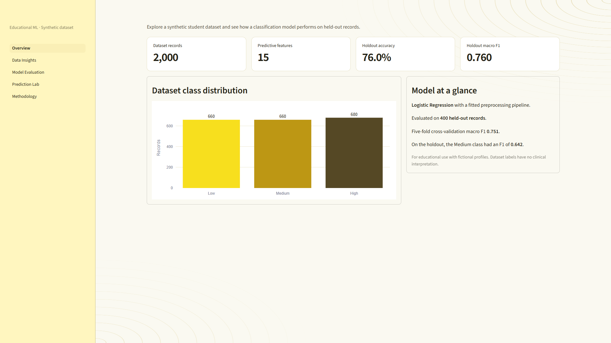

# Student Wellbeing Lab

A five-page Streamlit dashboard for exploring a synthetic student wellbeing dataset, comparing classifiers, and testing the saved model with fictional profiles.

**Educational use only.** The model predicts the dataset's Low, Medium, and High labels. Its probabilities have no established clinical validity. Use fictional inputs and avoid using this project for screening, diagnosis, student selection, discipline, or decisions about access to support.



[Data Insights](docs/screenshots/data-insights.png) · [Model Evaluation](docs/screenshots/model-evaluation.png) · [Prediction Lab](docs/screenshots/prediction-lab.png) · [Methodology](docs/screenshots/methodology.png)

## Verified results

The [source dataset](https://www.kaggle.com/datasets/maqdadali/mental-health-risk-prediction-dataset-students) contains 2,000 synthetic records, 15 predictive features, and 419 missing feature values. Class counts are 660 Low, 660 Medium, and 680 High.

| Classifier | Baseline CV macro F1 | Tuned CV macro F1 |
|---|---:|---:|
| Logistic Regression | 0.7506 | 0.7506 |
| RBF SVC | 0.7246 | 0.7365 |
| Random Forest | 0.6724 | 0.6747 |

The selected Logistic Regression pipeline (`C=10`) achieved **76.0% accuracy** and **0.7596 macro F1** on the 400-record holdout. Per-class F1 was **0.8154 Low**, **0.6415 Medium**, and **0.8218 High**. The saved model reproduced the committed confusion matrix on the reconstructed holdout.

Sources · [Saved notebook comparison](reports/metrics/notebook_comparison.json) · [Airflow evaluation](reports/metrics/airflow_evaluation.json)

## Run locally

Use Python 3.13. On Windows, run the following from the repository root in PowerShell.

```powershell
python -m venv .venv
.\.venv\Scripts\python.exe -m pip install -r requirements.txt
.\.venv\Scripts\python.exe -m streamlit run app/app.py --server.address 127.0.0.1
```

Open [the local dashboard](http://127.0.0.1:8501). The committed model and evaluation load immediately. Download the source CSV and place it at `data/raw/student_mental_health.csv` to enable dataset charts and filters. Start JupyterLab with `.\.venv\Scripts\python.exe -m jupyterlab` to inspect the notebooks. On Linux or macOS use `.venv/bin/python`.

## Architecture

| Stage | Implementation |
|---|---|
| Explore and validate | [Notebooks](notebooks/) and [validation script](scripts/data_validation.py) |
| Split and transform | Stratified 80/20 split, seed 42. The [scikit-learn pipeline](scripts/data_preprocessing.py) imputes, caps social-media hours at total screen time, scales numeric values, and encodes categories. |
| Compare and evaluate | [Training notebook](notebooks/03_model_training.ipynb) compares models using five stratified folds. The selected pipeline is evaluated on a holdout. |
| Orchestrate | [Airflow DAG](dags/sc1_pipeline.py) validates, splits, fits, evaluates, and publishes a matching pair of artifacts under `data/processed/`. |
| Serve | [Streamlit application](app/app.py) reads local artifacts and the synthetic CSV, charts aggregates with Plotly, and scores fictional inputs in memory. |

The main stack is Python, pandas, NumPy, scikit-learn, Joblib, Streamlit, Plotly, JupyterLab, Apache Airflow, and Docker Compose with PostgreSQL and Redis. Load Joblib files only from trusted sources.

### Optional Airflow workflow

Airflow runs independently of the dashboard. Use Docker Desktop with Linux containers. For fresh local setup, create an untracked `.env` containing `AIRFLOW_UID=50000` and a valid Fernet key. Keep an existing key when reusing the Airflow database. To generate a fresh file on Windows only when it is absent:

```powershell
if (-not (Test-Path .env)) {
    $keyBytes = [byte[]]::new(32)
    $rng = [System.Security.Cryptography.RandomNumberGenerator]::Create()
    $rng.GetBytes($keyBytes)
    $rng.Dispose()
    $fernet = [Convert]::ToBase64String($keyBytes).Replace('+','-').Replace('/','_')
    @("AIRFLOW_UID=50000", "FERNET_KEY=$fernet") | Set-Content -Encoding ascii .env
}
docker compose config --quiet
docker compose build
docker compose up -d
docker compose ps
```

Open [local Airflow](http://127.0.0.1:8080), locate `sc1_ml_pipeline`, and unpause it to enable the Monday 08:00 schedule in `Africa/Casablanca`. You can also trigger it from the Airflow UI after placing the CSV in the data directory. Compose is configured for local development. Set your own Airflow credentials and JWT secret before using any shared environment.

Each completed run writes its model and evaluation into a run-specific folder, then switches the dashboard to both via a single publication pointer. The repository's committed artifacts serve as the initial snapshot. Re-running the DAG on the same CSV reuses the same holdout.

## Limitations

The synthetic labels and their generation process do not establish real-world validity. The Medium class is harder to classify, and calibration and subgroup generalization have not been established. The full dataset was explored before model development, so holdout interpretation should account for possible influence on modeling choices. Prediction inputs are not written to disk.
